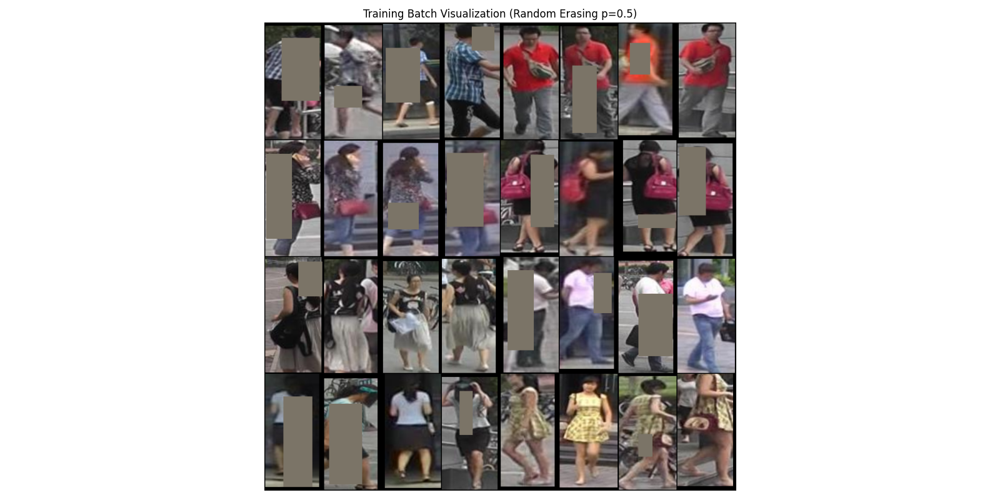

# Orion-Lite: 面向边缘设备的轻量化行人重识别系统

<p align="center">
  <b>MobileNetV4 + Coordinate Attention + Circle Loss · Apple Silicon (MPS / CoreML) 端侧部署</b>
</p>

<p align="center">
  
  
  
  
  <a href="LICENSE"></a>
</p>

---

## 1. 项目简介

**Orion-Lite** 是一个面向边缘计算设备的轻量化行人重识别（Person Re-Identification, ReID）训练与推理框架，针对 **Apple Silicon (M1 Pro MPS / ANE)** 进行了算子与部署适配。系统以 `MobileNetV4-Conv-Small` 为骨干网络，结合 `Coordinate Attention`、步幅调整（`Last Stride = 1`）、`BNNeck` 解耦头与 `Circle Loss` 度量学习，在 **3.46M** 参数量与 **2.3ms/张** 的端侧推理延迟下，在 Market-1501 数据集上取得 **86.58% Rank-1** 与 **80.06% mAP**。

### 核心技术选型

| 模块 | 方案选型 | 文献来源 | 设计说明 |
| :--- | :--- | :--- | :--- |
| **骨干网络** | `MobileNetV4-Conv-Small` | ECCV 2024 ([arXiv:2404.10518](https://arxiv.org/abs/2404.10518)) | 取消末层下采样 (`Last Stride = 1`)，保留高分辨率空间特征 |
| **注意力机制** | `Coordinate Attention` | CVPR 2021 ([arXiv:2103.02907](https://arxiv.org/abs/2103.02907)) | 沿水平与垂直方向编码长程空间位置依赖 |
| **特征解耦头** | `BNNeck` | CVPRW 2019 ([BoT](https://openaccess.thecvf.com/content_CVPRW_2019/papers/TRMTMCT/Luo_Bag_of_Tricks_and_a_Strong_Baseline_for_Deep_Person_CVPRW_2019_paper.pdf)) | BN 前特征计算度量损失，BN 后特征计算分类 ID 损失 |
| **度量学习损失** | `Circle Loss` | CVPR 2020 ([arXiv:2002.10857](https://arxiv.org/abs/2002.10857)) | 自适应调整正负样本对梯度权重，配合 Label Smoothing 交叉熵联合优化 |
| **重排序与部署** | `k-reciprocal Re-ranking` + `CoreML` | CVPR 2017 / Apple CoreML | 支持离线查询重排序与 `.mlpackage` 端侧半精度导出 |

---

## 2. 模型架构与数据增广

```text
Input Image (3 × 256 × 128)
      │
      ▼
┌───────────────────────────────────────────────────────┐
│  MobileNetV4-Conv-Small Backbone                      │
│  • Last Stride = 1 (输出 16 × 8 特征图)                │
│  • Coordinate Attention (方向感知空间注意力)           │
└───────────────────────────────────────────────────────┘
      │
      ▼
┌───────────────────────────────────────────────────────┐
│  BNNeck Head                                          │
│  • Global Average Pooling → 1×1 Conv (512-d) → BN     │
└───────────────────────────────────────────────────────┘
      │
      ├─────────────────────────┬───────────────────────┐
      ▼                         ▼                       ▼
Circle Loss (BN 前特征)   ID Loss (BN 后特征)   L2 归一化检索特征 (推理)
```

训练阶段采用随机水平翻转、填充裁剪与随机擦除（Random Erasing, $p=0.5$）模拟行人局部遮挡：

<p align="center">
  
</p>

---

## 3. 实验结果 (Market-1501)

### 3.1 精度与复杂度对比

| 指标 | Orion-Lite v2.0 | ResNet-50 (BoT Baseline) | 对比变化 |
| :--- | :---: | :---: | :--- |
| **Rank-1** (w/o Re-ranking) | **82.48%** | 94.50% | 轻量化单次前向检索 |
| **Rank-1** (w/ Re-ranking) | **86.58%** | - | k-reciprocal 重排序后提升 +4.10% |
| **mAP** (w/ Re-ranking) | **80.06%** | 85.90% | 兼顾多机位跨镜召回率 |
| **参数量 (Params)** | **3.46M** | ~25.0M | 参数规模缩减 **86%** |
| **单图推理延迟 (M1 Pro)** | **~2.3 ms** | ~45.0 ms | 端侧推理提速约 **20×** |

### 3.2 Apple M1 Pro 骨干网络吞吐实测

| 骨干网络 | 参数量 | MPS 推理延迟 | 吞吐量 |
| :--- | :---: | :---: | :---: |
| `MobileNetV4-Conv-Small` | 2.49M | 2.26 ms / img | ~440 img/s |
| `GhostNetV2-100` | 4.88M | 8.50 ms / img | ~118 img/s |

---

## 4. 仓库结构

```text
orion-lite-reid/
├── orion_lite/                 # 核心算法库
│   ├── configs/default.py      # 默认超参数与模型配置
│   ├── data/                   # Market-1501 数据集读取、PK 采样器与随机擦除增广
│   ├── engine/                 # 训练循环与 Rank-1 / mAP 评测引擎
│   ├── losses/                 # Circle Loss、CrossEntropy (Label Smoothing) 与组合损失
│   ├── modeling/
│   │   ├── backbones/          # MobileNetV4、GhostNetV2 与 Coordinate Attention
│   │   └── heads/              # LinearHead 与 BNNeckHead
│   └── utils/                  # k-reciprocal 重排序、权重加载与日志工具
├── scripts/                    # 训练、评估与 CoreML 推理主入口
│   ├── train.py                # 训练主程序
│   ├── evaluate.py             # Market-1501 指标评测脚本
│   └── inference_coreml.py     # CoreML 端侧推理测试
├── tools/                      # 数据预处理、转换与基准测试工具
│   ├── prepare_market1501.py   # 数据集目录校验与预处理
│   ├── benchmark_backbones.py  # 骨干网络延迟与吞吐测试
│   ├── export_coreml.py        # PyTorch 权重转 CoreML (.mlpackage)
│   ├── verify_coreml.py        # PyTorch 与 CoreML 输出数值一致性校验
│   ├── plot_metrics.py         # 训练曲线绘制
│   └── visualize_batch.py      # 训练 Batch 增广可视化
├── demo/                       # 交互演示程序
│   ├── app.py                  # Gradio 网页检索演示 (YOLOv8 检测 + Orion-Lite 检索)
│   └── webcam_demo.py          # 本地摄像头实时框选与目标重识别追踪
└── requirements.txt            # Python 依赖声明文件
```

---

## 5. 快速开始

### 5.1 环境配置

```bash
conda create -n orion_lite python=3.11 -y
conda activate orion_lite
pip install -r requirements.txt
```

### 5.2 数据准备

将 `Market-1501-v15.09.15` 解压至 `datasets/Market-1501-v15.09.15/`，运行校验脚本：

```bash
python tools/prepare_market1501.py
```

### 5.3 模型训练与评估

```bash
# 训练模型 (MobileNetV4 + BNNeck + Circle Loss)
python scripts/train.py \
    --loss_type circle \
    --circle_gamma 128 \
    --epochs 150 \
    --head_type bnneck

# 评估模型并启用 k-reciprocal 重排序
python scripts/evaluate.py --checkpoint checkpoints/best.pth --rerank
```

### 5.4 CoreML 导出与校验

```bash
# 导出为 Apple CoreML 格式 (.mlpackage)
python tools/export_coreml.py --checkpoint checkpoints/best.pth

# 校验 CoreML 与 PyTorch 特征余弦相似度
python tools/verify_coreml.py
```

### 5.5 运行交互式演示

```bash
# 启动 Gradio Web 演示界面（支持上传视频/图片进行检测与检索）
python demo/app.py

# 启动本地摄像头实时重识别演示（按 A 框选目标，按 C 清空，按 Q 退出）
python demo/webcam_demo.py
```

---

## 6. 参考文献

1. Qin, D., et al. "MobileNetV4 - Universal Models for the Mobile Ecosystem." *ECCV 2024*.
2. Sun, Y., et al. "Circle Loss: A Unified Perspective of Pair Similarity Optimization." *CVPR 2020*.
3. Hou, Q., et al. "Coordinate Attention for Efficient Mobile Network Design." *CVPR 2021*.
4. Luo, H., et al. "Bag of Tricks and a Strong Baseline for Deep Person Re-Identification." *CVPRW 2019*.
5. Zhong, Z., et al. "Re-ranking Person Re-identification with k-reciprocal Encoding." *CVPR 2017*.

---

## 7. 开源许可

本项目采用 [MIT License](LICENSE) 开源。

