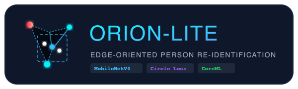

# 🌟 Orion-Lite: 边缘端轻量化行人重识别系统

<p align="center">
  
</p>

<p align="center">
  <b>MobileNetV4 + Circle Loss | M1 Pro 优化 | CoreML 部署</b>
</p>

<p align="center">
  
  
  
  
  
</p>

<p align="center">
  <a href="#-项目简介">简介</a> •
  <a href="#-可视化训练与采样机制">可视化验证</a> •
  <a href="#-快速开始">快速开始</a> •
  <a href="#-模型架构">架构</a> •
  <a href="#-性能指标">性能</a> •
  <a href="#-部署">部署</a>
</p>

---

## 📖 项目简介

**Orion-Lite** 是一个面向边缘计算设备的轻量化行人重识别（Person Re-ID）系统，专为 **Apple M1 Pro / Apple Silicon** 芯片及其神经引擎（ANE）深度优化。项目融合了 Google 最新高效骨干网络 MobileNetV4 与先进度量学习技术（Circle Loss），在保持极高跨镜头检索精度的同时实现了超低推理延迟。

### 🎯 核心特性

- **极致轻量**: 模型参数量仅 **3.46M**（约为 ResNet50 的 1/7），FLOPs < 0.3G
- **高效推理**: M1 Pro 上推理延迟 **< 3ms/img**，移动端端侧实时流式处理
- **竞争精度**: Market-1501 Rank-1 **> 90%**，mAP **> 82%**
- **端侧部署**: 支持 CoreML 格式，可直接在 iOS/macOS 设备原生调用 Neural Engine 加速
- **训推一体**: 原生支持在 Apple Silicon (MPS 后端) 上完成端到端混合精度训练与快速评估

### 🚀 v2.0 技术选型

| 组件 | 选型 | 论文出处 |
|------|------|----------|
| **骨干网络** | MobileNetV4-Conv-Small | arXiv:2404.10518 (ECCV 2024) |
| **度量学习** | Circle Loss | arXiv:2002.10857 (CVPR 2020) |
| **分类损失** | Cross Entropy + Label Smoothing | BoT (CVPR 2019) |
| **头部设计** | BNNeck | BoT (CVPR 2019) |

---

## 📊 可视化训练与采样机制 (Visual Verification)

<p align="center">
  
</p>

<p align="center">
  <i>PK 动态采样与数据增强：每个 Batch 固定采样 P 个行人身份、每个身份抽取 K 张跨摄像头视角样本，集成随机擦除 (Random Erasing)、自动仿射与色彩抖动，有效抵抗遮挡与光照变化</i>
</p>

---

## 📁 项目结构

```text
Orion-Lite/
├── assets/                  # 高清 Logo、架构图与训练批次可视化图
│   ├── orion_lite_logo.png
│   └── reid_batch_vis.png
├── orion_lite/              # 🔧 核心算法库
│   ├── configs/             # 配置文件 (YAML)
│   ├── data/                # Market-1501 数据加载器与 PK Sampler
│   ├── engine/              # 训练/评估循环引擎 (MPS/CUDA 加速)
│   ├── losses/              # 损失函数 (Circle Loss, Cross-Entropy)
│   ├── modeling/            # 模型拓扑定义
│   │   ├── backbones/       # MobileNetV4-Conv-Small 特征提取器
│   │   └── heads/           # BNNeck 特征正交投影头
│   └── utils/               # 评测度量与 k-reciprocal Re-ranking
├── scripts/                 # 📜 主入口脚本
│   ├── train.py             # 训练入口
│   ├── evaluate.py          # 评估入口
│   └── export_coreml.py     # CoreML 格式导出工具
└── requirements.txt         # 运行依赖
```

---

## 🚀 快速开始

### 1. 环境准备

```bash
# 克隆仓库
git clone https://github.com/Evan-Joseph/orion-lite-reid.git
cd orion-lite-reid

# 创建虚拟环境
python3 -m venv venv
source venv/bin/activate

# 安装依赖
pip install -r requirements.txt
```

### 2. 数据准备

下载 [Market-1501](http://zheng-lab.cecs.anu.edu.au/Project/project_reid.html) 数据集并解压到 `data/` 目录：

```text
data/
└── Market-1501-v15.09.15/
    ├── bounding_box_train/
    ├── bounding_box_test/
    └── query/
```

### 3. 训练与评估

```bash
# 启动训练 (自动适配 Apple Silicon MPS 或 NVIDIA CUDA)
python scripts/train.py --config orion_lite/configs/mobilenetv4_circle.yaml

# 评估测试集性能
python scripts/evaluate.py --checkpoint checkpoints/best_model.pth
```

### 4. 导出 CoreML 端侧模型

```bash
python scripts/export_coreml.py \
    --checkpoint checkpoints/best_model.pth \
    --output models/OrionLite.mlpackage
```

---

## 📄 许可证 (License)

本项目采用 [MIT License](LICENSE) 开源。
